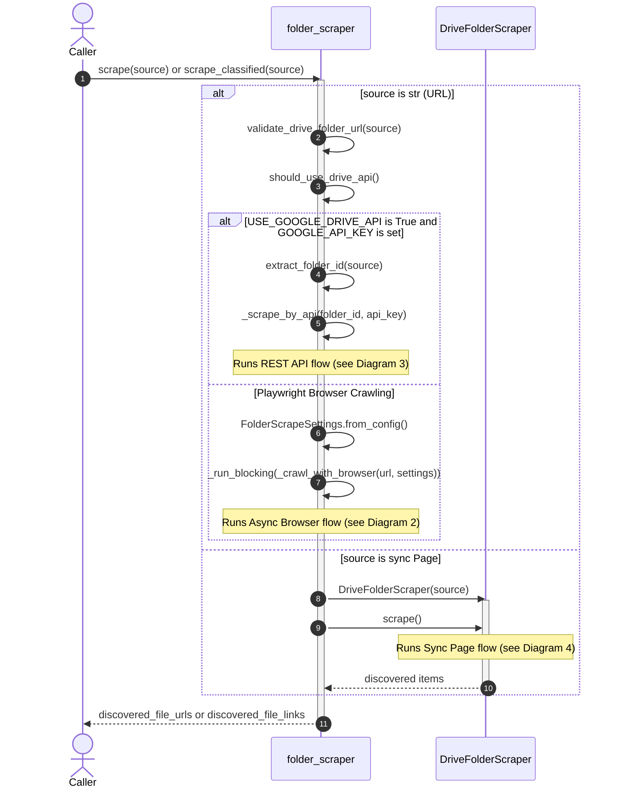
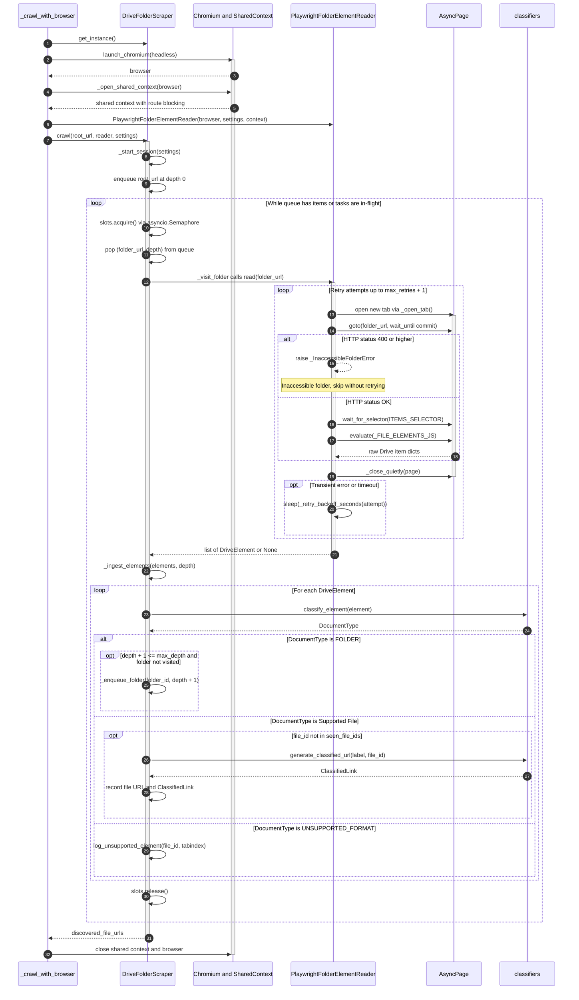
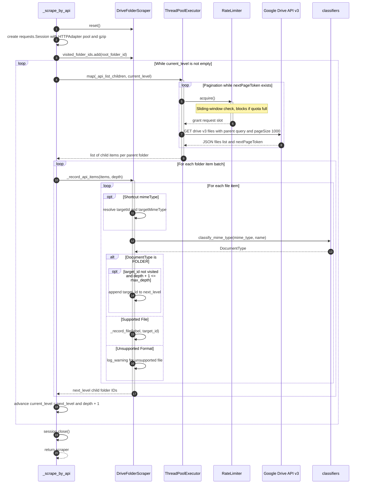
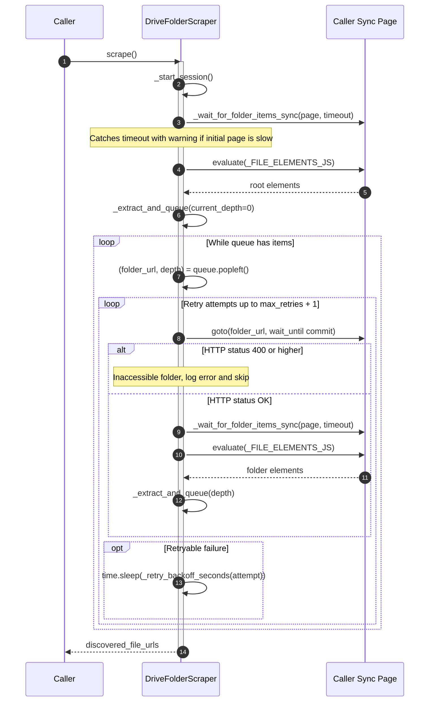

# Google Drive Folder Scraper Sequence Diagrams

This document illustrates the execution lifecycles and interactions across the components in [`folder_scraper.py`](file:///media/New%20Volume/projects/Python/Scraper/folder_scraper.py).

---

## 1. Top-Level Entry & Engine Dispatch Flow

When a caller invokes `scrape()` or `scrape_classified()`, `_scrape_source()` routes execution to either the **Google Drive v3 REST API**, the **Async Playwright Multi-Tab Crawler**, or the **Sync Playwright Sequential Crawler**.

---

## 2. Playwright Async Multi-Tab Concurrent Crawl (URL Mode)

When crawling a folder URL with Playwright, a single `AsyncBrowser` and shared `AsyncBrowserContext` are spawned. The queue is drained concurrently using an `asyncio.Semaphore`, reading each folder in a short-lived tab with asset route blocking.

---

## 3. Google Drive REST API v3 Scraping Flow (`_scrape_by_api`)

When the REST API backend is active, folder exploration executes as a concurrent, rate-limited level-order BFS across folders at each depth level.

---

## 4. Playwright Synchronous In-Place Crawl (Page Mode)

When an existing `playwright.sync_api.Page` is passed, the scraper executes sequentially in-place within that page without modifying the browser lifecycle.

