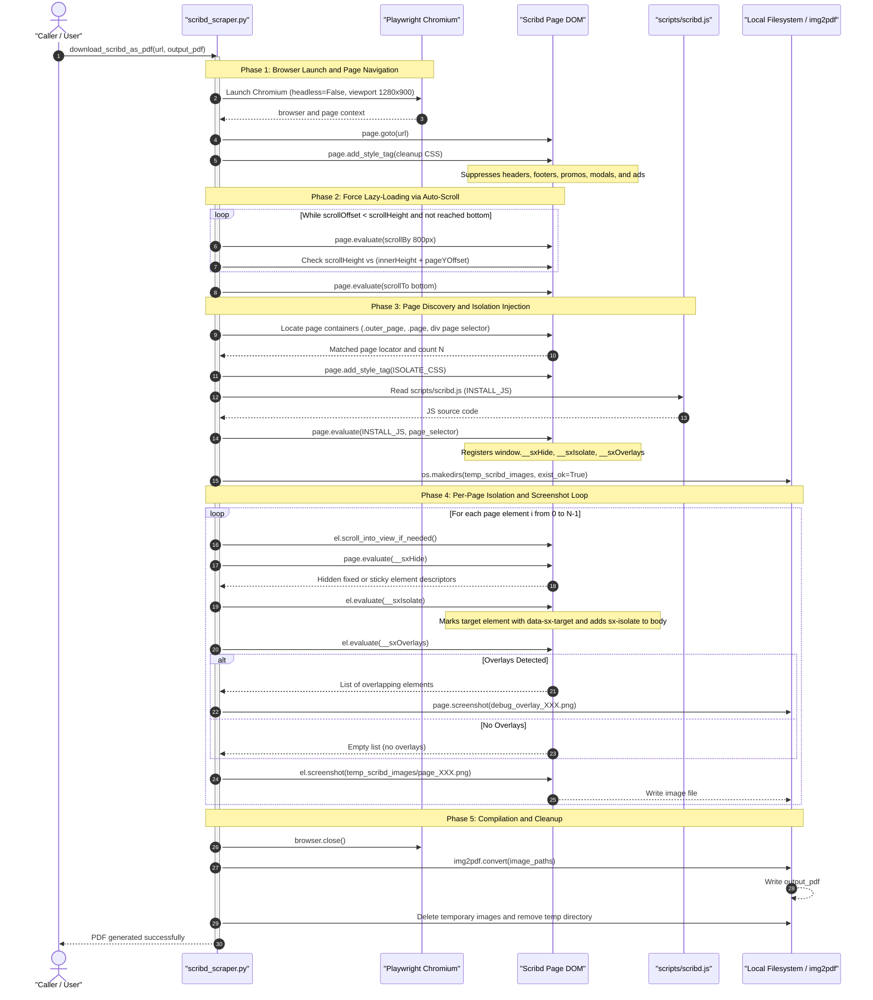

# Scribd Document Scraper Sequence Diagram

This document illustrates the execution lifecycle and interactions in [`scribd_scraper.py`](file:///media/New%20Volume/projects/Python/Scraper/scribd_scraper.py) for the `download_scribd_as_pdf()` function.

---

## 1. High-Level Sequence Diagram

The diagram below details the entire flow from initial document navigation and automated lazy-loading to per-page DOM isolation, screenshot capture, and final PDF generation.

---

## 2. Component Responsibilities & Phase Descriptions

### Phase 1: Browser Launch & Navigation
- **Playwright Chromium**: Launches in non-headless mode to avoid bot-detection heuristics and accommodate optional authentication.
- **Initial CSS Cleanup**: Injects an initial style tag that hides global site headers, footers, promo bars, overlays, and ads with `display: none !important`.

### Phase 2: Lazy-Load Forcing
- Scribd virtualizes its document viewer, rendering pages only when scrolled into proximity.
- An iterative scroll loop scrolls the viewport down by 800px increments until `window.innerHeight + window.pageYOffset >= document.body.scrollHeight`.

### Phase 3: Page Discovery & Isolation Setup
- **Page Selectors**: Probes known container selectors (`.outer_page`, `.page`, `div[id^='page_']`) to identify individual pages.
- **`ISOLATE_CSS`**: Hides all elements on `body.sx-isolate` with `visibility: hidden !important` unless they are marked with `[data-sx-target]`. Using `visibility: hidden` maintains page geometry and prevents reflow.
- **`scripts/scribd.js`**: Injects three client-side helper utilities:
  1. `window.__sxHide()`: Suppresses floating sticky/fixed nodes.
  2. `window.__sxIsolate(el)`: Targets exactly one page and activates the isolation mode on `body`.
  3. `window.__sxOverlays(el)`: Performs grid sampling using `document.elementFromPoint` to verify no elements overlap the page.

### Phase 4: Per-Page Isolation & Screenshot Capture
- Iterates over each discovered page element:
  - Scrolls the page into view.
  - Hides background elements and floating toolbars.
  - Verifies that no overlaying nodes obstruct the view.
  - Captures an isolated screenshot to `temp_scribd_images/page_{i:03d}.png`.

### Phase 5: PDF Merging & Cleanup
- Closes the Chromium browser context.
- Aggregates all temporary `.png` screenshots into a unified PDF file via `img2pdf`.
- Removes all temporary screenshot files and deletes the staging folder.
